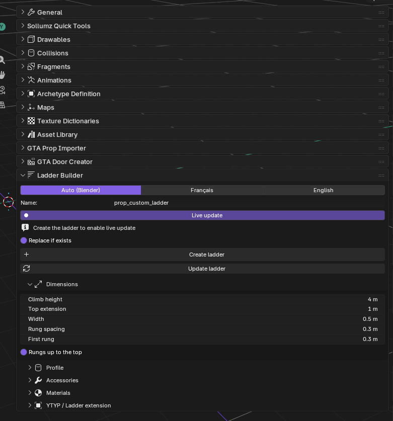
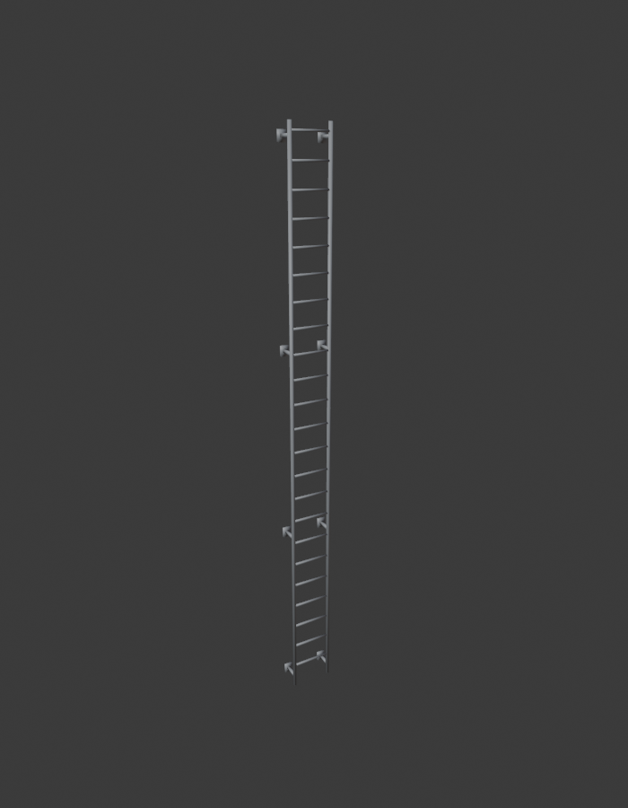
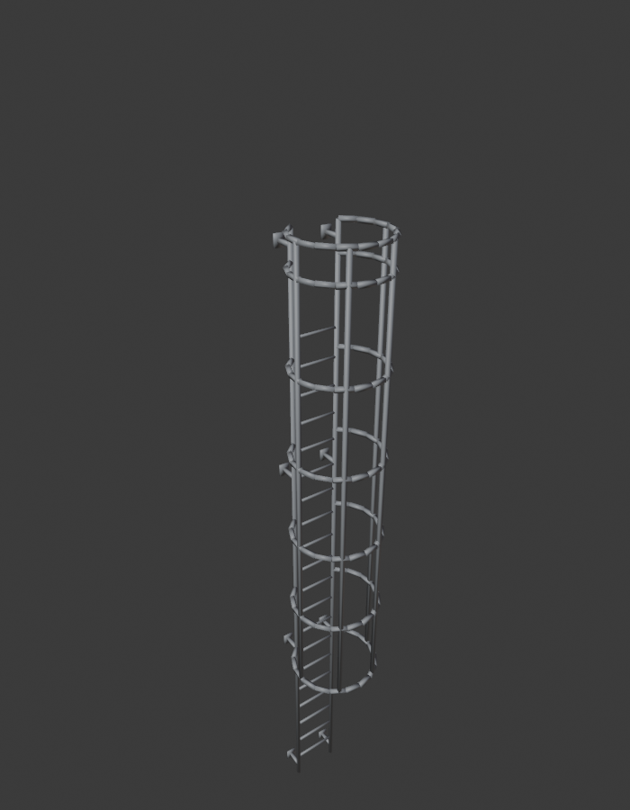

# Byfred Ladder Builder

Addon Blender pour [Sollumz](https://github.com/Sollumz/Sollumz) qui crée une échelle GTA V / FiveM prête à l'emploi : modèle 3D, collision et YTYP avec l'extension Ladder.

*Blender add-on for [Sollumz](https://github.com/Sollumz/Sollumz) that builds a ready-to-use GTA V / FiveM ladder: 3D model, collision and YTYP with the Ladder extension. — [English below](#english)*



| Échelle simple | Avec crinoline |
|---|---|
|  |  |

## Français

### Ce que l'addon génère
- **Modèle 3D** : Drawable Sollumz, shader `default.sps`, texture métal intégrée (pas besoin de `.ytd`).
- **Collision** intégrée au `.ydr` (Composite → BVH → poly), matériau au choix.
- **YTYP** : archetype + extension `CExtensionDefLadder` (top, bottom, normal, type d'échelle, sorties haut/bas).
- Options : profil rond ou carré, fixations murales, crinoline (cage de sécurité), barreaux jusqu'en haut.
- **Temps réel** : changer la hauteur ou un autre réglage met l'échelle à jour directement.
- Interface en **français** et en **anglais**.

### Installation
1. Installe et active **Sollumz** (Blender 4.2 ou plus récent).
2. Télécharge `byfred_ladder_builder.zip` dans la page **Releases** (ou zippe le dossier `byfred_ladder_builder`).
3. Blender → *Edit > Preferences > Add-ons > Install from Disk* → choisis le zip.

### Utilisation
1. Vue 3D → touche **N** → onglet **Sollumz Tools** → **Byfred Ladder Builder**.
2. Règle les options, puis clique sur **Créer l'échelle**.
3. Exporte avec Sollumz (le modèle, puis le YTYP).
4. Dans ta ressource FiveM, mets le `.ydr` et le `.ytyp` dans `stream/` et ajoute dans `fxmanifest.lua` :
   ```lua
   data_file 'DLC_ITYP_REQUEST' 'stream/custom_ladders.ytyp'
   ```

**Astuce :** la *Hauteur à grimper* doit correspondre à la hauteur de la plateforme d'arrivée. Si le personnage s'accroche du mauvais côté, change le *Côté grimpeur*.

## English

### What it generates
- **3D model**: Sollumz Drawable, `default.sps` shader, embedded metal texture (no `.ytd` needed).
- **Collision** embedded in the `.ydr` (Composite → BVH → poly), selectable material.
- **YTYP**: archetype + `CExtensionDefLadder` extension (top, bottom, normal, ladder type, get off at top/bottom).
- Options: round or square profile, wall brackets, safety cage, rungs up to the top.
- **Live update**: changing the height or any setting updates the ladder instantly.
- **French** and **English** interface.

### Installation
1. Install and enable **Sollumz** (Blender 4.2 or newer).
2. Download `byfred_ladder_builder.zip` from **Releases** (or zip the `byfred_ladder_builder` folder).
3. Blender → *Edit > Preferences > Add-ons > Install from Disk* → pick the zip.

### Usage
1. 3D View → press **N** → **Sollumz Tools** tab → **Byfred Ladder Builder**.
2. Adjust the settings and click **Create ladder**.
3. Export with Sollumz (the model, then the YTYP).
4. In your FiveM resource, put the `.ydr` and `.ytyp` in `stream/` and add to `fxmanifest.lua`:
   ```lua
   data_file 'DLC_ITYP_REQUEST' 'stream/custom_ladders.ytyp'
   ```

**Tip:** *Climb height* must match the height of the platform at the top. If the ped grabs the ladder from the wrong side, switch the *Climber side*.

## Licence / License
GPL-3.0 — voir / see [LICENSE](LICENSE).
